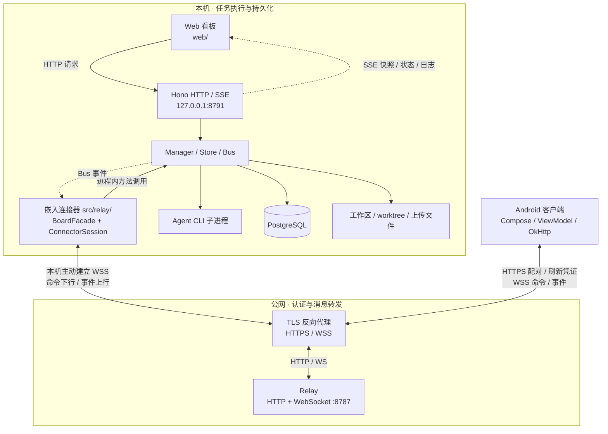
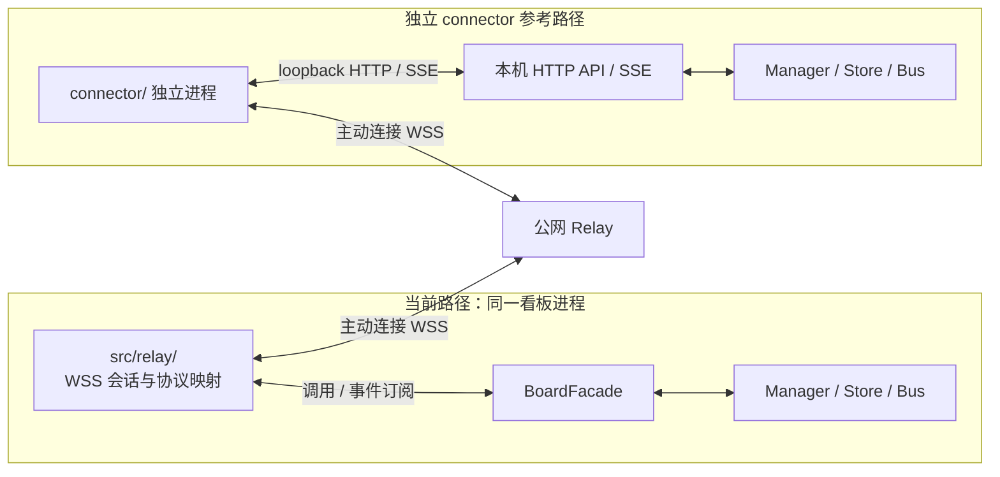
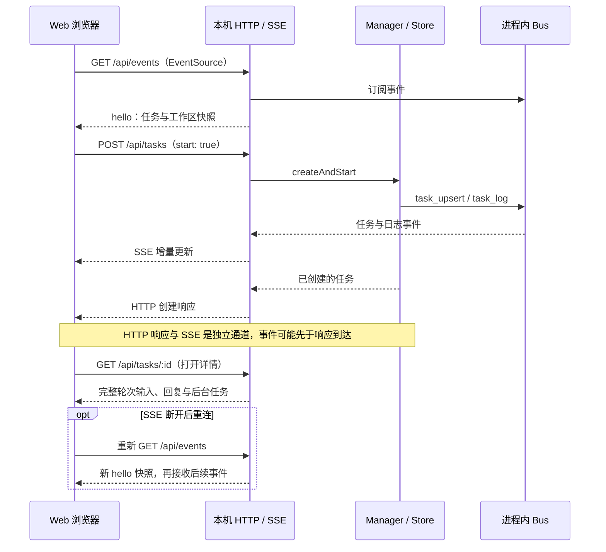
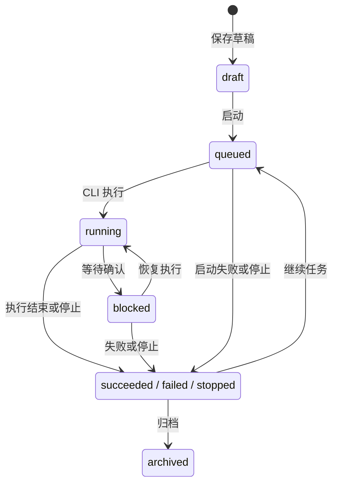
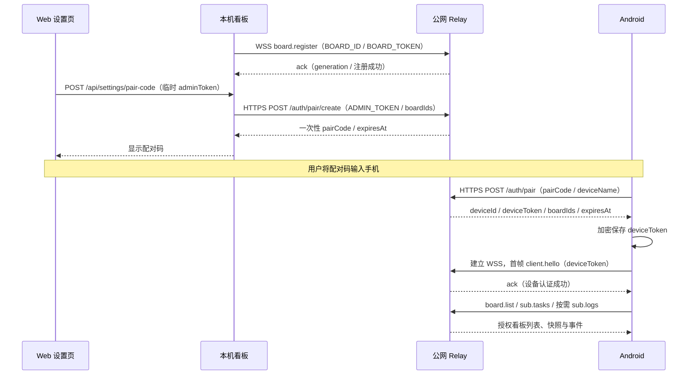
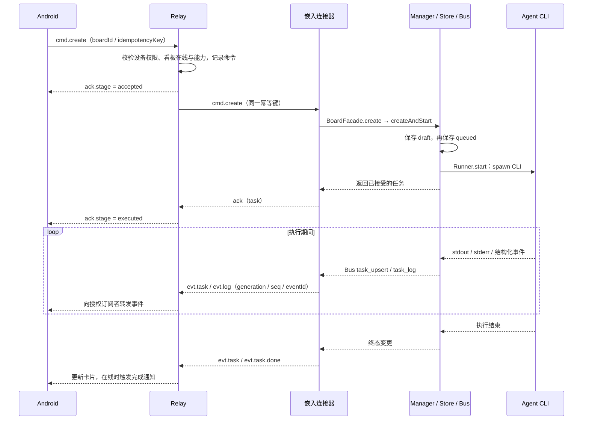
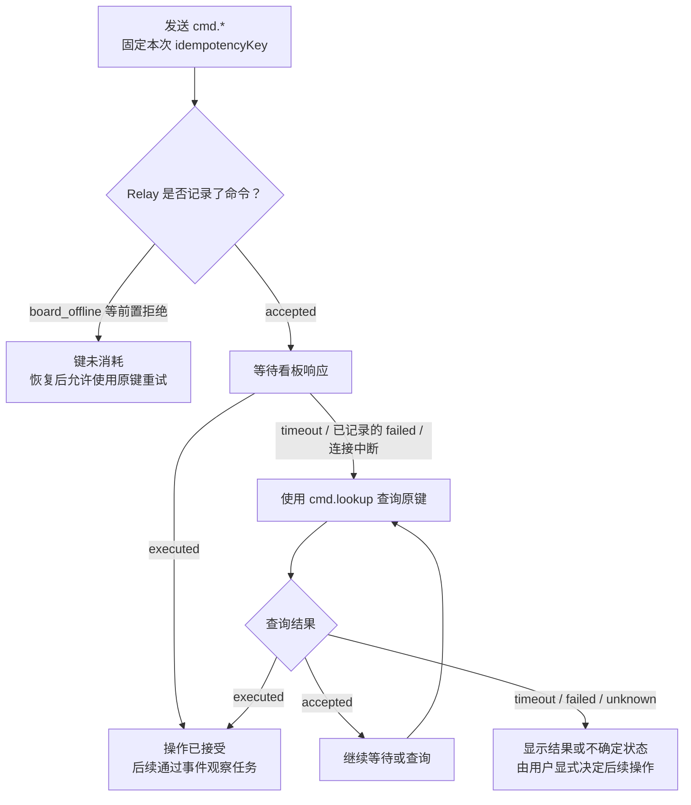
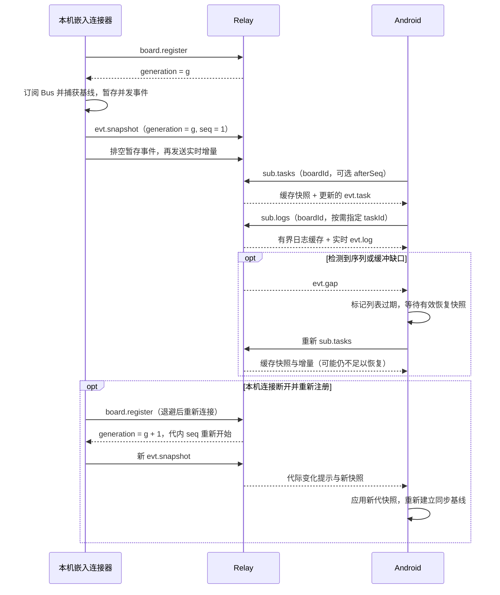
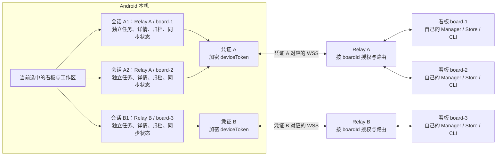

Agent Board 以本机看板服务为核心：工作区指向本机目录，任务由本机安装的 Agent CLI 执行，任务数据保存到 PostgreSQL。浏览器通过 HTTP 和 SSE 操作看板；Android 客户端通过公网 Relay 远程操作同一个看板。

本文描述仓库当前实现。接口字段和部署参数分别见 [HTTP API 文档](http://127.0.0.1:8791/docs)、[Relay 协议](https://github.com/mengfei0053/agent-board/blob/HEAD/PROTOCOL.md)和[项目 README](https://github.com/mengfei0053/agent-board#readme)。

## 整体拓扑

浏览器和 Android 最终调用同一套任务管理逻辑。本机服务拥有任务执行状态和持久化数据；Relay 负责认证、消息路由和短期缓存。远程连接由本机主动拨出，手机只连接 Relay，无需向公网暴露看板的 HTTP 端口。

仓库还保留独立 `connector/`：它作为单独进程连接 Relay，再通过本机 HTTP/SSE 接入看板。当前本机运行路径使用 `src/relay/` 的嵌入拨号，通过 `BoardFacade` 直接调用进程内能力。同一 `BOARD_ID` 只应启用一种连接方式。

### 通信通道一览

| 两端 | 连接发起方与通道 | 请求方向 | 返回与推送方向 |
| --- | --- | --- | --- |
| Web ↔ 本机看板 | 浏览器发起 HTTP 和 SSE 长连接 | 浏览器 → HTTP API | HTTP 响应；看板 → SSE 事件 |
| Android ↔ Relay | 手机发起 HTTPS 和 WSS | 配对、刷新、订阅、`cmd.*` | 设备凭证、`ack` / `err`、`evt.*` |
| 嵌入连接器 ↔ Relay | 本机服务主动建立 WSS | 注册、命令结果、任务事件 → Relay | 注册响应、远程命令 → 本机 |
| 嵌入连接器 ↔ 本机核心 | 同一 Node.js 进程内调用和订阅 | `BoardFacade` → Manager / Store / Settings | 返回值和 Bus 事件 |
| 独立 connector ↔ 本机看板 | connector 发起 loopback HTTP / SSE | connector → HTTP API | HTTP 响应和 SSE 事件 |
| Manager ↔ Agent CLI | 本机创建子进程 | argv / cwd / env，停止信号 | stdout / stderr / exit |

WSS 是双向长连接。“本机主动拨出”描述连接建立方向；连接建立后，手机命令仍可经 Relay 下行到本机。Relay 不主动连接本机 HTTP，也不访问工作区、数据库或运行 CLI。

### 两种本机接入方式

上图是两种可选部署方式的对照。嵌入方式直接复用本机方法和 Bus；独立方式经 HTTP/SSE 适配。同一看板不要同时运行两种注册方。下面的远程通信时序以嵌入方式为例。

## 仓库组成与职责

| 目录 / 文件 | 技术与职责 |
| --- | --- |
| `src/server.ts` | Node.js、TypeScript、Hono；HTTP 路由、请求校验、SSE、静态页面、启动和关闭入口 |
| `src/manager.ts` | 任务生命周期编排、进程句柄、按任务串行操作、输出与后台任务汇总 |
| `src/runners/` | pi、Claude Code、Cursor CLI、Devin CLI、Codex CLI 适配；命令参数、日志解析、会话续跑和停止 |
| `src/store.ts`、`src/db.ts` | 内存镜像、PostgreSQL 表结构与读写、写队列、旧数据迁移和启动恢复 |
| `src/bus.ts`、`src/types.ts` | 进程内事件发布订阅，以及工作区、任务、泳道和事件的数据类型 |
| `src/relay/` | 嵌入拨号、协议映射、命令队列、幂等、快照与事件同步；`facade.ts` 封装看板能力 |
| `web/` | 原生 HTML/CSS/JavaScript 看板、全局设置、工作区设置和本机 API 文档；由 Hono 直接提供 |
| `relay/` | 独立 Node.js 服务，使用 HTTP 和 `ws`；配对、凭证、连接、授权、命令路由、短期事件缓存 |
| `connector/` | 独立 Node.js 连接器；把远程协议译成本机 HTTP 请求，把 SSE 译成 Relay 事件 |
| `android/app/` | Kotlin、Jetpack Compose、ViewModel、OkHttp；手机界面、连接、命令交互和系统通知 |
| `android/protocol/` | Kotlin/JVM 协议模块；信封解析、任务状态合并、命令恢复、多看板会话与表单逻辑 |
| `website/` | Docusaurus 文档站，独立生成静态网站；与 `web/` 的任务看板分别运行和构建 |
| `test/`、`scripts/`、`.github/` | 集成与浏览器测试、本机启动和截图脚本、APK 构建发布工作流 |

根目录 `package.json` 管理看板，`pnpm-workspace.yaml` 额外纳入 `website/`。`relay/` 和 `connector/` 各有自己的 `package.json`，Android 使用 Gradle；根目录测试命令不包含所有子项目的检查。

## 本机服务的分层

### HTTP 与界面

`server.ts` 负责解析和校验输入，把任务操作交给 `manager.ts`，把存储、设置和工作区操作交给对应模块。主要入口包括 `/api/tasks`、`/api/workspaces`、`/api/settings`、`/api/uploads` 和 `/api/events`。Webhook 使用 `/api/hooks/tasks`，需单独配置 `AGENT_BOARD_WEBHOOK_SECRET`。

`web/app.js` 用 `fetch` 发起操作，用 `EventSource` 订阅 `/api/events`。SSE 连接先收到 `hello` 快照，之后接收 `task_upsert`、`task_delete`、`task_log`、`workspace_upsert`、`workspace_delete`，并以 `ping` 保活。前端合并增量更新，打开详情时再读取完整任务和日志，避免每次刷新都传输全部输出。

SSE 每个连接使用有上限的发送队列；客户端消费过慢时会断开，由重连后的新快照恢复视图。`bus.ts` 是当前进程内的发布订阅机制。

本机 SSE 通过重新发送当前快照恢复，没有持久化事件游标重放。Web 收到 HTTP 响应时只代表该操作返回，后续任务状态持续由 SSE 更新。

### 任务管理

`manager.ts` 是任务执行的统一入口，负责创建草稿、启动、停止、继续、移动泳道、归档和删除。它维护任务与 `RunnerHandle` 的对应关系，并对同一任务的 start / move / stop / continue 串行处理，减少并发请求造成的状态冲突。

每次执行还有独立的运行标识。旧进程回调或延迟输出补丁如果属于上一轮执行，就会被忽略，避免覆盖新一轮的任务状态。高频输出和后台任务更新会合并，再更新 Store 和事件总线。

### Agent CLI 适配

`runners/index.ts` 按 `AgentKind` 注册实现，统一接口位于 `runners/types.ts`：`start(task, hooks, opts)` 返回可停止的句柄，执行期间通过 `onStatus` 和 `onLog` 回报。

| Agent | 执行与会话方式 |
| --- | --- |
| pi | JSON 模式，使用 `--session-id` 保存和复用会话 |
| Claude Code | `stream-json`；首跑指定会话 ID，续跑使用 `--resume` |
| Cursor CLI | `agent create-chat` 获取会话，使用 `agent -p`、`stream-json` 和 `--resume` |
| Devin CLI | `devin -p` 的文本输出；已有会话 ID 时通过 `-r` 续跑 |
| Codex CLI | `codex exec --json`；从事件获取 thread ID，续跑使用 `exec ... resume` |

`runners/common.ts` 集中处理 `spawn`、stdout/stderr 按行读取、退出和错误、进程组停止与超时升级为 `SIGKILL`。CLI 路径和按 Agent 配置的代理环境变量在启动子进程时应用。看板调用 CLI，模型访问和登录凭证由各 CLI 自身管理。

续跑优先使用任务自己的 `sessionId`。缺少会话 ID 时，以原始任务和追加指令创建新会话，避免接入同一目录下其他任务的最近会话；Devin 当前也不会自动绑定目录中的最新 session。

`extractOutput.ts` 从日志中提取助手回复和每轮输出；`sideJobs.ts` 识别子代理、Monitor 和后台工具调用。这些后台条目是事件流的观察结果，其执行仍由对应 Agent CLI 管理。

## 任务执行与状态

以“新建 Todo”为例：

1. 浏览器提交 `POST /api/tasks`，传入 Agent、prompt、工作区和 `start: true`；手机则发送 `cmd.create`，由 `BoardFacade` 接入同一创建流程。
2. Manager 解析工作区与 cwd；选择 worktree 时，校验 Git 根目录和 HEAD 并创建隔离目录及分支。
3. 创建 `draft` 任务并等待落库，再将任务更新为 `queued` 并等待落库，随后启动对应 Runner。仅创建草稿时，到保存草稿为止。
4. 启动前将上传引用展开为本机路径，并把工作区指令加入 prompt；Runner 在任务 cwd 中调用 CLI。
5. CLI 输出经解析后更新状态、会话 ID、回复、日志和后台任务；Store 负责保存，Bus 向浏览器 SSE 和嵌入 Relay 发布变更。
6. 执行结束后记录终态。继续任务会增加 `iteration`、保存本轮输入，并在已有 CLI 会话上启动下一轮执行。

主要执行路径为：

实际状态还会受 CLI 事件、错误和泳道操作影响。`queued` 是启动前状态，当前实现会立即尝试启动本机进程，没有独立的分布式任务队列或全局并发调度器。

| Web 泳道 | 本机任务状态 |
| --- | --- |
| 草稿 | `draft` |
| Todo | `queued` |
| 进行中 | `running`、`blocked` |
| 已完成 | `succeeded`、`failed`、`stopped` |
| 归档 | `archived` |

归档后任务只读。删除会跳过 `queued` / `running`；删除仍有进程句柄的可删除任务时，先停止进程再清理数据。归档不等于再次完成，不会触发手机完成通知。

## 数据模型与持久化

`Workspace` 保存目录、名称和工作区设置；`Task` 通过 `workspaceId` 关联工作区，保存 Agent 类型、cwd、prompt、状态、会话 ID、迭代次数及可选的附件和 worktree 信息。用户的代码和 CLI 会话数据仍保留在本机文件系统及各 CLI 自己的存储中。

| PostgreSQL 表 | 内容 |
| --- | --- |
| `workspaces` | 工作区目录及设置 |
| `tasks` | 任务主记录、状态、当前输出、附件引用和 worktree 元数据 |
| `task_prompts`、`task_outputs` | 按任务与迭代次数保存输入和回复 |
| `task_logs` | 有保留上限的任务日志 |
| `task_side_jobs` | 从事件流识别的后台任务状态 |
| `uploads` | 上传文件元信息；文件内容位于 `UPLOADS_DIR`，默认 `data/uploads/` |
| `meta` | 默认工作区、CLI 路径、代理、快捷提示词、Codex sandbox 等配置 |

`store.ts` 维护工作区、任务和日志的内存镜像，供同步读取。创建、启动和续跑等关键步骤等待数据库写入成功；高频状态与日志更新使用异步写队列，合并任务快照并批量写入日志。因此实时界面可能先于后台写队列完成更新。持久化失败会记录降级状态，`/api/health` 返回 `503`；`flushPersist()` 用于排空写入并报告未恢复的失败。

当前日志保存在内存和 PostgreSQL 中，并按行数、字符数裁剪；每轮回复单独存储。`data/db.json` 和 `data/logs/*.jsonl` 是旧格式，启动时支持一次性迁移和归档 JSON，不应把 JSONL 当作当前持续写入的日志来源。归档任务会清理原始日志，保留任务及轮次内容。

### 启动与关闭

启动时先初始化上传目录、表结构和默认工作区，迁移旧数据并载入内存，恢复设置，清理孤儿数据，再监听 HTTP。数据库中遗留的 `queued` / `running` / `blocked` 会被标记为中断失败；服务重启不会重新接管旧 CLI 子进程。HTTP 开始监听后，才按配置启动嵌入 Relay 拨号。

收到 `SIGINT` / `SIGTERM` 后，服务先关闭 Relay 拨号并停止重连，再进入排空状态、拒绝新的写请求、关闭 HTTP、停止 Runner、刷新持久化队列，最后关闭数据库连接。因此有运行中任务时应避免重启看板。

## Git、工作区配置与上传

`gitStatus.ts` 对已保存工作区做有深度、目录数和仓库数限制的只读扫描，并短暂缓存结果。它同时识别 `.git` 目录和 worktree 的 `.git` 文件；Git 子进程会过滤可能改变仓库定位的环境变量。

`gitWorktree.ts` 只接受带有可用 HEAD 的 Git 工作树根目录。任务选择隔离执行后，cwd 变为 `<原目录>/.agent-board/worktrees/<taskId>`，分支为 `agent-board/<taskId>`。删除时验证所属路径和 Git 登记信息；有未提交改动则保留并返回警告。worktree 提供代码目录隔离，任务的执行权限仍由 CLI 和宿主环境决定。

工作区的 `systemPrompt`、skills 和 MCP 说明由 `workspaceApply.ts` 组装为 prompt 前缀。首跑或无会话的续跑会加入前缀，已有会话续跑沿用上下文；当前 MCP 设置以文本说明传给 Agent，尚未为每种 CLI 注入原生 MCP 配置。

上传文件经 `uploads.ts` 校验并保存，任务中记录引用，运行前将引用转换为绝对路径。图片通过 Markdown 展示；普通附件使用附件元信息传递。孤儿文件清理带数据库 owner 标识，测试和多实例需配置独立的 `DATA_DIR` / `UPLOADS_DIR`。

## Relay 与远程同步

### 配对和授权

Relay 使用独立的 `ADMIN_TOKEN` 创建有时效的一次性配对码；Android 通过配对码换取绑定设备和可访问 `boardIds` 的 device token。看板通过 `BOARD_TOKEN` 发送 `board.register`，手机通过 device token 发送 `client.hello`。这些凭证用途各自独立，WebSocket token 通过首帧发送。

本机设置页可以临时提交管理员令牌，为当前看板生成配对码；管理员令牌不会保存在看板设置中。Android 将凭证存入 `EncryptedSharedPreferences`，普通看板目录和工作区选择等偏好另行保存。

`boardIds` 决定设备能访问哪些看板，`capabilities` 决定看板支持哪些命令。配对码成功兑换后即失效；刷新 device token 会轮换凭证并关闭旧 socket。设备断线不会停止本机已经启动的任务。

### 命令与事件

远程命令采用带版本号的 JSON 信封。Relay 校验权限和看板能力，将 `cmd.create`、`cmd.stop`、`cmd.continue`、工作区及设置命令转给本机。嵌入连接器通过 `BoardFacade` 调用 Manager、Store 和设置模块，并将总线事件转换成 `evt.snapshot`、`evt.task`、`evt.log` 等协议事件。

`ack.stage: accepted` 表示 Relay 已记录并转发命令；`executed` 表示看板已接受操作。任务是否执行完成仍要看任务状态和 `evt.task.done`。超时后客户端使用 `cmd.lookup` 查询原命令，避免盲目重新创建任务。

图中将命令结果和事件流分段展示；实际事件可能先于 `executed` 到达，客户端不能依赖两条通道的相对顺序。命令响应通过 `payload.ref` 关联请求；事件按 `boardId`、`generation`、`seq`、`eventId` 合并。`accepted`、`executed` 和任务终态表示不同阶段。

### 超时查询与幂等

Relay 的命令键按看板和命令类型区分，在缓存有效期内重复提交返回原记录。`unknown` 仅表示当前查不到记录，可能已过期或服务已重启，不能据此断定任务没有创建。超时或断线后的恢复优先查询，重新发起不同命令需显式生成新键。

每次看板注册都会获得新的 `generation`，代内使用递增 `seq` 和 `eventId` 检测缺口及重复。手机先接收快照，再应用增量；收到 `evt.gap` 后保持列表过期标识并重新同步。归档任务不进入远程活动快照，通过独立分页命令读取。

### 快照、增量与断线恢复

`sub.tasks` 的缓存重放只补任务状态，日志由 `sub.logs` 单独订阅；`evt.task.done` 不重放。收到旧缓存快照、日志或单个任务更新，不能直接清除 `evt.gap` 引起的过期标识；需要能覆盖缺口的恢复快照，或新一代快照。手机重新连接时还会先认证、查询看板列表，并对未确认的命令执行 lookup。

本机状态在协议映射时会转换，例如 `kind` 变为 `agent`、`blocked` 变为 `paused`、草稿映射为 `queued`。完整协议能力以根目录 `PROTOCOL.md` 为准，不能直接把手机快照当作本机 Task 原始数据。

### 可靠性边界

Relay 的配对、设备凭证、连接、幂等记录和最新快照均只存在内存中，重启后不会恢复这些记录，需要重新配对和注册。看板离线时，远程命令立即返回 `board_offline`，不会排队等待上线。

Relay 在有效期内缓存命令结果，本机连接器也维护有界的进程内幂等缓存；两者都不提供跨进程重启的恰好一次执行保证。嵌入连接器使用有界命令队列和事件缓冲，断线后指数退避重连并发送新快照。

Android 的完成通知来自在线 WebSocket 收到的 `evt.task.done`，按 `eventId` 去重；当前没有离线推送服务，完成事件也不会作为离线通知重放。

## Android 客户端

Compose 界面通过 `BoardViewModel` 管理配对、多看板选择、任务和工作区、详情、设置、归档及命令状态。`data/OkHttpRelay.kt` 封装 HTTP 与 WebSocket，`data/SessionStore.kt` 负责凭证与本机目录持久化，`notify/DoneNotifier.kt` 处理完成通知。

`android/protocol/` 将信封解析、任务合并、搜索、命令超时查询、会话目录迁移和恢复等逻辑抽离为 Kotlin/JVM 模块，可脱离设备进行单元验证。手机保存的是访问会话和界面偏好，任务的持久化记录仍由本机看板维护。

### 多看板与多工作区隔离

这是允许的多看板拓扑示例：一个凭证可以授权多个 `boardId`，同一凭证复用一个 WebSocket；不同凭证分别管理连接。Android 按会话保存看板视图，通过凭证、socket 连接代次、`boardId` 和请求引用路由消息，避免切换后旧连接或旧详情响应污染当前界面。

看板内的工作区选择和搜索在手机本地完成，工作区切换本身不发送 Relay 命令；创建任务传入 `workspaceId`，工作区创建和删除才发送 `cmd.workspace.*`。从手机“忘记看板”只清理本机会话，不删除远端看板或任务。

## 部署与验证

典型部署是本机运行看板及 Agent CLI，Compose 仅运行 PostgreSQL；公网主机运行 TLS 反向代理和 Relay。看板默认监听 `127.0.0.1:8791`，Relay 默认监听 `127.0.0.1:8787`，Compose 数据库对本机映射 `5433`。完整 `app` 镜像不包含 Agent CLI 或登录态，容器中执行任务需要自行挂载配置。

本机 API 以本机访问为信任边界，普通看板接口没有统一用户认证和细粒度角色权限；公网访问通过 Relay 的设备和看板授权完成。当前服务还依赖进程内 Runner 句柄、锁和 Bus，同一套看板数据应由一个服务实例负责执行。多个看板可以注册到 Relay，但各自拥有独立的执行进程和存储配置。

| 验证范围 | 入口与方式 |
| --- | --- |
| 看板静态检查 | 根目录 `pnpm typecheck` |
| 看板单元测试 | `pnpm test:unit`，覆盖解析、Runner 参数、设置和生命周期等 |
| 看板集成测试 | `pnpm test:integration`，真实 Hono API + embedded PostgreSQL + fake Runner |
| Web 交互 | `pnpm test:e2e`，Puppeteer + mock API |
| Relay | 在 `relay/` 执行 `npm test`、`npm run e2e`，验证协议、路由、授权和网络链路 |
| 独立 connector | 在 `connector/` 执行 `npm test`，连接真实 Relay 和本机 mock 看板 |
| Android | 在 `android/` 执行 `./gradlew test assembleDebug`；协议 JVM 测试与 APK 构建 |
| 文档站 | 根目录 `pnpm docs:build`，检查页面编译与站内链接 |

进一步修改时，可从所影响的边界进入：新增 Agent 修改 Runner 及相关类型和界面选项；新增远程能力同步修改看板协议映射、Relay 校验和 Android 协议；修改持久化数据时同时检查表结构、内存恢复、迁移和删除清理路径。
